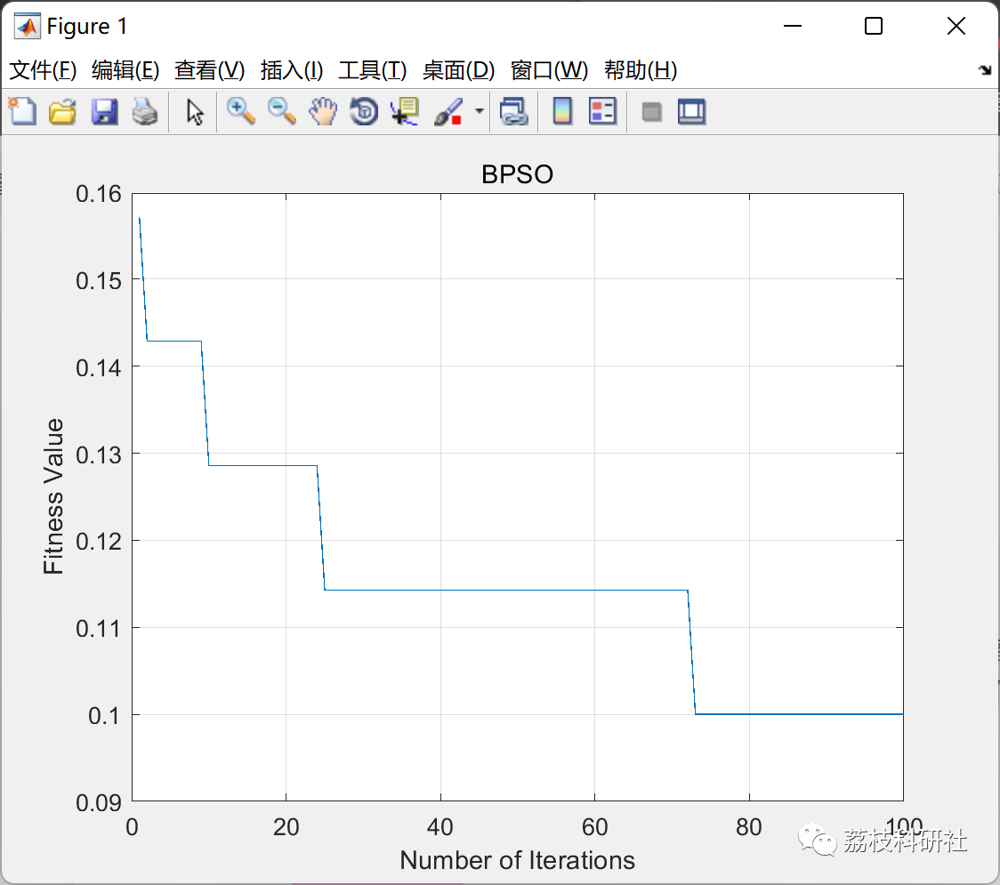

# Bi-Particle Swarm Optimization Algorithm Based on Feature Selection (Matlab Code Implementation)

💥💥💞💞 Welcome to this blog❤️❤️💥💥
🏆 Bloggers' Advantages: 🌞🌞🌞 The content of the blog strives for rigorous thinking and clear logic to facilitate readers.
⛳️ Mantra: A journey of a thousand miles is begun with a single step.
Litchi Research Society
Code Collection: Electric power systems, intelligent algorithms and applications, neural network prediction, path planning, optimization scheduling, workshop scheduling, image processing, signal processing...
🎁 Special Section Links:
🌈🌈🌈🌟🌟🌟 Electrical Code Intelligent Algorithms and Applications Path Planning Neural Network Prediction Optimization Scheduling Image Processing Workshop Scheduling Signal Processing Romantic Her
💥1 Overview
This program is used for feature selection in binary particle swarm optimization (BPSO), which can select potential features to improve classification accuracy. It also explains how to use BPSO with classification error rate (calculated by KNN) as the fitness function for feature selection problems using benchmark datasets.
📚2 Running Results
🎉3 References
[1] Too, Jingwei, et al. "A New Co-Evolution Binary Particle Swarm Optimization with Multiple Inertia Weight Strategy for Feature Selection." Informatics, vol. 6, no. 2, MDPI AG, May 2019, p. 21, doi:10.3390/informatics6020021.
[2] Also, Jingwei et al. "EMG Feature Selection and Classification Using a Pbest-Guide Binary Particle Swarm Optimization." Computation, vol. 7, no. 1, MDPI AG, Feb. 2019, p. 12, doi:10.3390/computation7010012.
🌈4 Matlab Code Implementation
Click the article's lower left corner to read in full.

## Images

<!-- PAYMENT_BLOCK -->

## Get this dataset

- Payment link (Stripe): [Buy now](https://buy.stripe.com/3cs8yP7sY87d0vu9AB)
- Payment QR code: 

<!-- /PAYMENT_BLOCK -->
